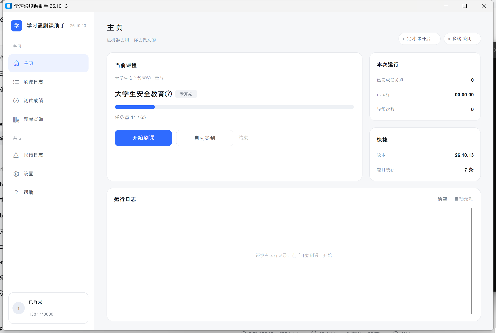

# 学习通刷课助手

一个 Windows 桌面端的课程自动化工具：自动看完视频 / PPT / 直播 / 音频 / 阅读，自动回复讨论、完成章节测验与作业，并支持自动签到。界面使用 customtkinter 重写过，浅色极简风格。



## 功能

- **自动刷课**：自动登录、选课、逐个任务点往下推进，支持视频、PPT、直播、音频、阅读、讨论
- **断点续刷**：刷完的课程自动标记并跳过，中途停下的课程下次优先接着刷，可在「刷课日志」里重置断点
- **自动答题**：章节测验 / 作业自动作答，答案来源为「本地缓存 → 免费题库 → DeepSeek」，支持单选、多选、判断、填空、简答、论述
- **视频内题目**：答错会自动换下一个选项重试，不会卡在弹题上
- **自动签到**：轮询课程中「普通签到 / 位置签到」并自动完成，位置签到带坐标修正
- **人脸认证**：可自动处理课程中弹出的人脸认证
- **定时刷课**：设定每天的开始与结束时间，到点自动开跑 / 收工
- **运行记录**：刷课日志、测试成绩、题目缓存、报错日志都在界面里查看与清理
- **多端学习**：可同时推进多门课程（有风控风险，默认关闭）

## 环境要求

- Windows 10 / 11
- Python 3.9 以上（开发与验证环境为 3.11）
- Microsoft Edge（推荐，项目自带 Edge 驱动）或 Chrome（需自备同版本驱动）

## 安装

```bash
pip install -r requirements.txt
```

## 运行

```bash
python start.py
```

首次启动先到「设置」页填好账号、密码、课程名并保存，再回主页点「开始刷课」。

打包成单个 exe：

```bash
python -m PyInstaller --onefile --noconsole start.py
```

## 配置

所有配置保存在 `task/tool/account_info.json`，在界面「设置」页里填写即可，不需要手改文件。主要选项：

| 选项 | 说明 |
| --- | --- |
| 浏览器 / 驱动地址 | Edge 可不填驱动，使用自带的 `task/tool/edge_driver/msedgedriver.exe` |
| 课程 | 最多 3 门，名称必须和学习通里完全一致 |
| 章节测验 | `DeepSeek AI` / `随机答题` / `不刷题` |
| 答完题后 | 仅保存、强制提交，或答对率达到指定比例再提交 |
| 视频题目 | `DeepSeek AI` 或 `随机答题` |
| 倍速 | 1–16 倍，建议 1–2 倍，过高可能被判定异常 |
| API Key | 使用 DeepSeek 答题时需要，可在 DeepSeek 官网申请 |
| 跳过人脸 / 多端学习 / 秒过视频 / 防锁屏 | 按需开启 |
| 定时刷课 | 每天固定时间段自动开始和结束 |

> 账号密码与 API Key 以明文保存在本地配置文件里，请不要把这个文件发给别人，也不要把 `account_info.json` 提交到仓库（`.gitignore` 已排除）。

## 目录结构

```
start.py                 界面主程序（导航、进程、日志、定时）
main.py                  刷课工作进程（Selenium 自动化）
core/config_manager.py   配置读写
gui/
  theme.py               配色、字体、图标令牌
  widgets.py             卡片、胶囊、进度条等基础组件
  sidebar.py             左侧导航
  home_page.py           主页
  settings_page.py       设置页
  logs_page.py           日志 / 成绩 / 题库 / 报错 / 帮助
  sign_window.py         自动签到窗口
  timer_window.py        定时设置窗口
  user_notice.py         使用须知
task/
  xxt/                   签到相关的移动端接口封装
  tool/                  题库、字体解密、人脸、日志等工具
  watch_vido.py 等        各类任务点处理
mockups/                 界面设计稿与改造前后截图
```

## 常见问题

- **点击开始没反应**：确认设置页已保存账号信息；必要时用管理员权限运行
- **驱动版本不匹配**：下载与浏览器版本一致的驱动，在设置页重新选择
- **视频卡住**：确认浏览器窗口没被最小化，程序会自动刷新重试
- **题目答不对**：答案来自题库与 AI，仅供参考，可在「题库查询」里查看命中过的题目

更多说明见程序内「帮助」页。

## 免责声明

本项目仅供**个人学习、技术交流与研究参考**使用。

1. 请勿将本项目用于任何商业用途，也不要用于违反所在学校、平台规定的场景。
2. 工具只是自动化辅助，自动答题的结果、签到结果均不保证正确，**请自行判断**。
3. 使用本项目所产生的一切后果（包括但不限于账号被封禁、成绩异常、数据丢失、违反校规等）**由使用者自行承担，作者不承担任何责任**。
4. 本项目按「现状」提供，不提供任何形式的担保；作者没有义务修复问题或提供支持。
5. 下载、运行或使用本项目，即视为你已阅读并同意以上条款。如果你不同意，请不要使用。

## 联系方式

- 邮箱：numaforbus@gmail.com
- QQ：2023114826

有问题或建议欢迎联系，尽量描述清楚现象并附上报错日志。

## 许可

见 [LICENSE](LICENSE)。
