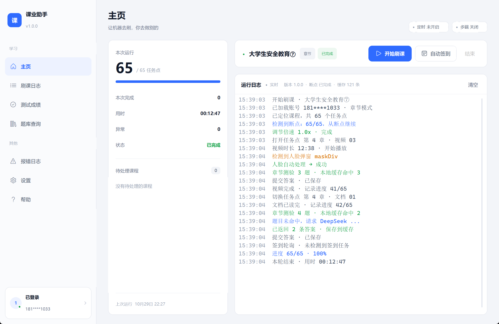
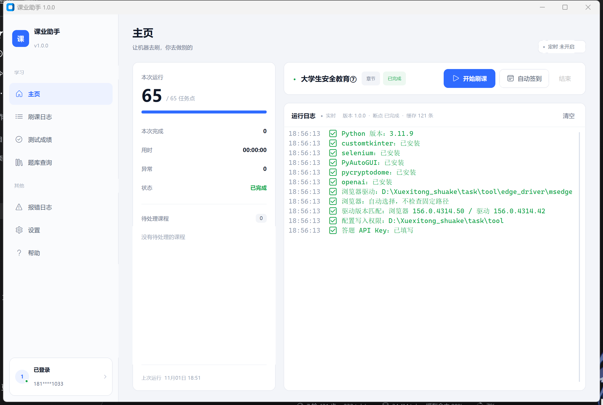

# 课业助手

一个 Windows 桌面端的课程自动化工具：自动看完视频 / PPT / 直播 / 音频 / 阅读，自动回复讨论、完成章节测验与作业，并支持自动签到。界面使用 customtkinter 编写，主页是「左进度、右日志」的工作台式布局，配色与组件统一由 `gui/theme.py` 的令牌驱动。



运行中的样子：



## 下载即用（不需要装 Python）

1. 打开 [Releases](https://github.com/L71615/Unlink-Xuexitong/releases)，下载最新的 `CourseHelper-1.3.0-win64.zip`。
2. 解压到任意目录（整个文件夹一起解压，别只把 exe 拖出来）。
3. 双击 `课业助手.exe`，第一次启动会自动检查环境。

首次运行 Windows 可能弹蓝色 SmartScreen 提示，点「更多信息」→「仍要运行」即可（exe 没有买代码签名证书）。

程序调用的是你电脑上已装的 Microsoft Edge，请保证 Edge 是正常安装的版本。包内自带 156、157 两个主版本的 Edge 驱动；Edge 是别的主版本时，程序会先找 `task/tool/edge_driver/<主版本>/` 下有没有对应驱动，没有就联网用 Selenium Manager 取一个。

想自己改代码 / 从源码运行，看下面的「安装」与「运行」。

## 功能

- **自动刷课**：自动登录、选课、逐个任务点往下推进，支持视频、PPT、直播、音频、阅读、讨论
- **断点续刷**：刷完的课程自动标记并跳过；中途停下的课程记到**章节、任务点、视频秒数**，下次直接从断点继续，可在「刷课日志」里重置断点
- **多账号**：保存多个手机号后可一键切换，密码用 Windows DPAPI 加密存在本机；设置页存账号，回主页点「登录」验证并读取课程
- **自动答题**：章节测验 / 作业自动作答，答案来源为「本地缓存 → 免费题库 → DeepSeek」，支持单选、多选、判断、填空、简答、论述
- **视频内题目**：答错会自动换下一个选项重试，不会卡在弹题上
- **倍速校准**：每个视频开始时读取实际播放倍速再补调，平台临时限速后不会一直按无效的按键
- **自动签到**：轮询课程中「普通签到 / 位置签到」并自动完成，位置签到带坐标修正
- **人脸认证**：视频里的人脸校验可自动处理（全程打印取图 / 上传 / 提交结果，失败会给出具体原因）；章节页的人脸采集会先做一次「软校验」（隐藏遮罩观察 12 秒，看弹窗是否被服务端推回、视频是否继续），不成立才需要本人用学习通扫码，默认等 60 秒（`face_wait` 可调），超时跳过该课程，不会刷新重试
- **定时刷课**：设定每天的开始与结束时间，到点自动开跑 / 收工；关掉程序后只要还在当前时段内，下次启动会补跑
- **待处理课程**：主页会列出上次中断 / 出错的课程，可以只重试这一门，也可以忽略
- **运行记录**：刷课日志、测试成绩、题目缓存、报错日志都在界面里查看与清理
- **环境自检**：启动时检查依赖、驱动、浏览器、写入权限和 API Key，还会读出浏览器与驱动的版本号比对；内置驱动对不上当前 Edge 时自动改用在线获取的驱动，不会一启动就报「only supports version」

## 界面

- **主页**：顶部是账号状态与「登录」按钮——登录成功后自动读取「我的课程」并列出，勾选要刷的课、选好倍速点「开始刷课」；左侧是本次运行面板（任务点进度、本次完成、用时、异常、状态、待处理课程、上次运行时间），右侧是控制条与实时运行日志；日志按成功 / 警告 / 错误着色，运行中「结束」按钮变为可点。
- **设置页**：只放账号（保存多个手机号、切换）、浏览器、答题策略与功能开关，课程与倍速都在主页选。
- **刷课日志 / 测试成绩 / 题库查询 / 报错日志**：共用列表与筛选组件，可按课程查看与清理。
- 配色、字号、圆角、间距统一收敛在 `gui/theme.py`，新页面直接复用 `gui/widgets.py` 的卡片、胶囊、按钮与图标。

## 环境要求

- Windows 10 / 11
- 用下载版：不需要 Python，只要装了 Microsoft Edge
- 从源码运行：Python 3.10 以上（开发与验证环境为 3.11）
- Microsoft Edge（推荐，项目自带 Edge 驱动）或 Chrome（需自备同版本驱动）

## 安装

```bash
pip install -r requirements.txt
```

## 运行

```bash
python start.py
```

首次启动先到「设置」页填好账号、密码并保存，回主页点「登录」——登录成功会自动读到你正在学的课程，勾选要刷的课、选好倍速，再点「开始刷课」。

打一个绿色免安装目录：

```bash
python build_exe.py                 # 产物 dist/课业助手/，双击 dist/课业助手/课业助手.exe
python build_exe.py --onefile       # 单文件版 dist/课业助手.exe（启动要解压，慢 5-10 秒）
python build_exe.py --fetch-drivers 156,155   # 顺便下几个主版本的 Edge 驱动打进包里
```

`--skip-build` 只准备 `build_assets/`，不调用 PyInstaller。

版本号只在 `version.py` 里改一处，界面标题、exe 属性、`task/tool/version_info` 都由它来。

## 配置

所有配置保存在 `task/tool/account_info.json`，在界面「设置」页里填写即可，不需要手改文件。主要选项：

| 选项 | 说明 |
| --- | --- |
| 浏览器 / 驱动地址 | Edge 可不填驱动，使用自带的 `task/tool/edge_driver/<主版本>/msedgedriver.exe` |
| 课程 | 在主页点「登录」后自动读取，勾选要刷的课，不限门数 |
| 章节测验 | `DeepSeek AI` / `随机答题` / `不刷题` |
| 答完题后 | 仅保存、强制提交，或答对率达到指定比例再提交 |
| 视频题目 | `DeepSeek AI` 或 `随机答题` |
| 倍速 | 主页的「本次任务」卡里选，1–16 倍，建议 1–2 倍，过高可能被判定异常 |
| API Key | 使用 DeepSeek 答题时需要，可在 DeepSeek 官网申请 |
| 自动处理人脸 / 秒过视频 / 防锁屏 | 按需开启；关闭「自动处理人脸」后不会自动提交，检测到采集弹窗仍会提示本人扫码 |
| 定时刷课 | 每天固定时间段自动开始和结束 |

> 账号密码与 API Key 以明文保存在本地配置文件里，请不要把这个文件发给别人，也不要把 `account_info.json` 提交到仓库（`.gitignore` 已排除）。

## 目录结构

```
start.py                 界面主程序（导航、进程、日志、定时）
main.py                  刷课工作进程（Selenium 自动化）
version.py               版本号单一来源（APP_NAME / APP_VERSION）
build_exe.py             打包脚本（onedir 默认，可 --onefile / --fetch-drivers）
core/config_manager.py   配置读写
core/resume.py           断点续刷状态（已刷完 / 中断的课程）
core/progress.py         任务点级断点（章节页 URL、视频位置）
core/accounts.py         多账号账号簿（密码经 DPAPI 加密）
core/timer_plan.py       定时区间计算（跨天、补跑、下次开始）
core/selfcheck.py        启动环境自检
core/browser.py          浏览器 / 驱动解析（版本比对、扩展与启动参数）
gui/
  theme.py               配色、字体、图标令牌
  widgets.py             卡片、胶囊、按钮、进度条等基础组件
  sidebar.py             左侧导航
  home_page.py           主页（账号状态/登录、课程勾选、倍速、运行面板、日志）
  settings_page.py       设置页（账号、浏览器、功能、高级）
  logs_page.py           日志 / 成绩 / 题库 / 报错 / 帮助
  sign_window.py         自动签到窗口
  timer_window.py        定时设置窗口
  onboarding.py          首次启动引导
  user_notice.py         使用须知
task/
  xxt/                   签到相关的移动端接口封装
  tool/                  题库、字体解密、人脸、倍速、日志等工具
  watch_vido.py 等        各类任务点处理
tests/                   单元测试（答案匹配、人脸守卫、定时、倍速、自检）
mockups/                 界面设计稿、方案对比与当前效果截图
```

## 更新日志

各版本的具体改动只在 GitHub Releases 里维护，本文件不再重复，点下面看：

- 全部版本：https://github.com/L71615/Unlink-Xuexitong/releases
- 最新版本：https://github.com/L71615/Unlink-Xuexitong/releases/latest

## 常见问题

- **点击开始没反应**：先看主页日志里的环境自检结果（依赖、驱动、浏览器、写入权限），再确认设置页已保存账号信息；必要时用管理员权限运行
- **驱动版本不匹配**：程序会比对浏览器与驱动的版本号；内置驱动按主版本放在 `task/tool/edge_driver/<主版本>/` 里，装哪个主版本就用哪个，对不上时自动改用在线获取的驱动。仍失败时下载与 Edge 主版本一致的 msedgedriver，在设置页指定路径
- **视频卡住**：确认浏览器窗口没被最小化，程序会自动刷新重试
- **题目答不对**：答案来自题库与 AI，仅供参考，可在「题库查询」里查看命中过的题目
- **人脸采集弹窗不消失**：程序会先试一次「软校验」——把遮罩藏掉，观察 12 秒：弹窗被服务端推回或视频停住，就说明是强制采集，只能本人用学习通 APP 扫码，程序等 120 秒后跳过该课程并记到「刷课日志」；遮罩没回弹且播放继续，则按已跳过处理。日志里搜「软校验」能看到是哪一种，失败时还会打印当前 URL 与 iframe src，方便换入口排查

- **换了账号点开始刷不了 / 日志提示「登录态未建立」**：1.1.1 起登录态按手机号分文件保存，换号时无需手动删 cookie；若仍失败，看日志里的「登录成功：昵称 (uid=…)」是否与要刷的号一致，并到 `debug/` 里最新的目录查看当时的截图与页面源码
- **启动浏览器失败 / 提示 `session not created`**：1.1.2 起浏览器配置目录改到软件自己的 `runtime/profile/`，不再依赖系统临时目录；若仍失败，先关掉多余的浏览器窗口重试，再看日志里打印的「配置目录」是否可写，最后清空 `%TEMP%` 下的 `scoped_dir*` 目录
- **报错信息在哪**：程序界面「报错日志」页可见，完整堆栈写在运行目录的 `error.log`；页面结构类问题还会在 `debug/` 下留现场

更多说明见程序内「帮助」页。

## 免责声明

本项目仅供**个人学习、技术交流与研究参考**使用。

1. 请勿将本项目用于任何商业用途，也不要用于违反所在学校、平台规定的场景。
2. 工具只是自动化辅助，自动答题的结果、签到结果均不保证正确，**请自行判断**。
3. 使用本项目所产生的一切后果（包括但不限于账号被封禁、成绩异常、数据丢失、违反校规等）**由使用者自行承担，作者不承担任何责任**。
4. 本项目按「现状」提供，不提供任何形式的担保；作者没有义务修复问题或提供支持。
5. 下载、运行或使用本项目，即视为你已阅读并同意以上条款。如果你不同意，请不要使用。

## 联系方式

- 邮箱：numaforbus@gmail.com
- QQ：3644368286

有问题或建议欢迎联系，尽量描述清楚现象并附上报错日志。

## 许可

见 [LICENSE](LICENSE)。
