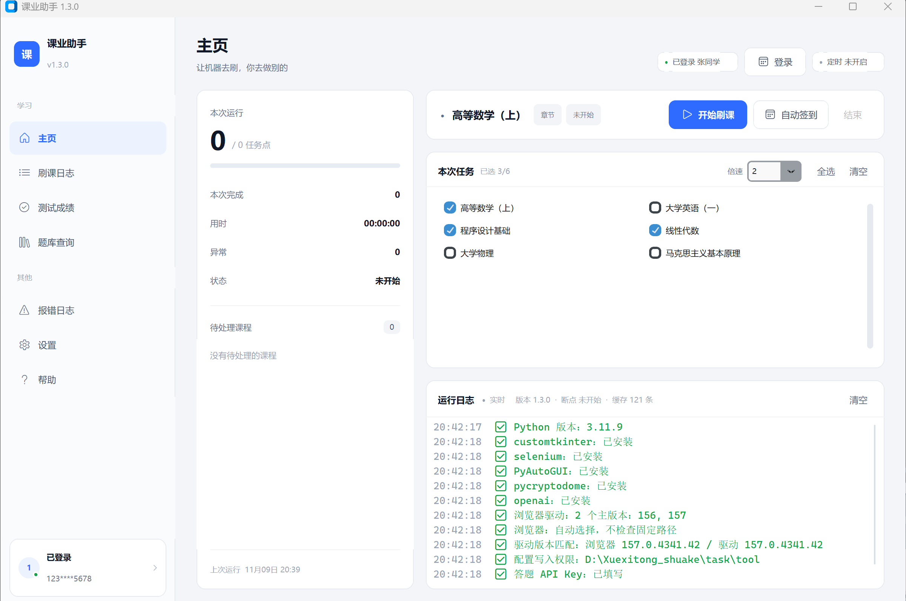
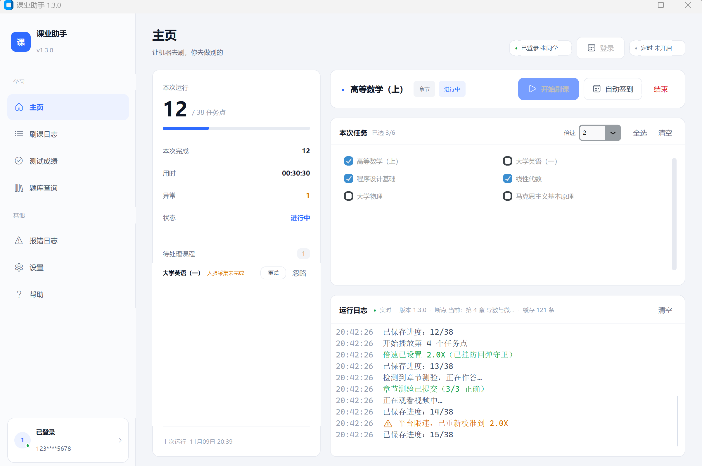
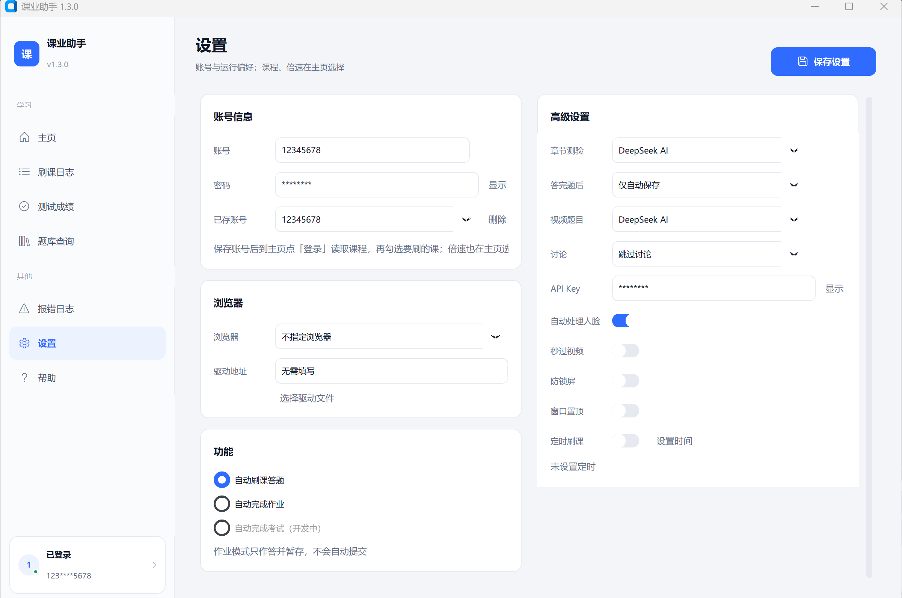

# 课业助手

一个 Windows 桌面端的课程自动化工具：自动登录、选课，逐个任务点看完视频 / PPT / 直播 / 音频 / 阅读，自动回复讨论、完成章节测验与作业，顺带把签到也做了。界面用 customtkinter 写，主页是「左进度、右日志」的工作台布局。



选好课、点「开始刷课」之后：



设置页只放账号与偏好，课程和倍速都在主页选：



## 下载即用（不需要装 Python）

1. 打开 [Releases](https://github.com/L71615/Unlink-Xuexitong/releases)，下载最新的 `CourseHelper-1.3.0-win64.zip`。
2. 解压到任意目录——**整个文件夹一起解压**，不要只把 exe 拖出来。
3. 双击 `课业助手.exe`，首次启动会先做一次环境自检，结果打在主页日志里。

第一次运行 Windows 可能弹蓝色 SmartScreen 提示，点「更多信息」→「仍要运行」即可（exe 没有购买代码签名证书）。

程序调用你电脑上已装的 **Microsoft Edge**，所以 Edge 需要是正常可用的版本。包里自带 156、157 两个主版本的驱动；Edge 升级到别的主版本时，会先看 `task/tool/edge_driver/<主版本>/` 里有没有对应驱动，没有才联网向 Selenium Manager 要一个。

## 四步开始刷课

1. 「设置」页填手机号、密码，点「保存设置」。
2. 回主页点右上角「登录」，等日志出现「读取到 N 门课程」——这一步会真的打开浏览器登录一次，顺便把登录态存下来。
3. 在「本次任务」卡片里勾选要刷的课（不限门数，可全选 / 清空），倍速也在这里选。
4. 点「开始刷课」。

## 功能

- **自动刷课**：自动登录、选课、逐个任务点往下推进，支持视频、PPT、直播、音频、阅读、讨论
- **断点续刷**：刷完的课程自动跳过；中途停下的课程记到**章节、任务点、视频秒数**，下次回到那一秒继续播，可在「刷课日志」里重置
- **多账号**：保存多个手机号一键切换，密码用 Windows DPAPI 加密存在本机，切换后重新点一次「登录」即可
- **自动答题**：章节测验 / 作业自动作答，答案来源「本地缓存 → 免费题库 → DeepSeek」，覆盖单选、多选、判断、填空、简答、论述
- **视频内题目**：答错自动换下一个选项重试，不会卡在弹题上
- **倍速校准**：直接给播放器写 `playbackRate` 并挂防回弹守卫，平台临时改回 1 倍会被压回去；写不进去才退回按键
- **自动签到**：轮询课程中的「普通签到 / 位置签到」并自动完成，位置签到带坐标修正
- **人脸认证**：视频里的人脸校验自动处理（取图、上传、提交结果全程打印）；章节页的人脸采集先做一次「软校验」，确认是强制采集才提示本人扫码，默认等 60 秒（`face_wait` 可调），超时跳过该课程而不是死等
- **定时刷课**：设定每天的开始与结束时间，到点自动开跑 / 收工；关掉程序后只要还在时段内，下次启动会补跑
- **待处理课程**：主页列出上次中断 / 出错的课程，可以只重试这一门，也可以忽略
- **运行记录**：刷课日志、测试成绩、题目缓存、报错日志都能在界面里查看与清理
- **环境自检**：启动时检查依赖、驱动、浏览器、写入权限和 API Key，并比对浏览器与驱动的版本号；内置驱动对不上当前 Edge 时自动改用在线获取的驱动

## 界面

- **主页**：顶部是账号状态与「登录」按钮；右上「本次任务」卡里勾课、选倍速；左侧是本次运行面板（任务点进度、本次完成、用时、异常、状态、待处理课程、上次运行）；右侧是控制条与实时日志，按成功 / 警告 / 错误着色。
- **设置页**：账号（多个手机号、切换）、浏览器与驱动、答题策略、高级开关（人脸、秒过视频、防锁屏、窗口置顶、定时刷课）。
- **刷课日志 / 测试成绩 / 题库查询 / 报错日志**：共用列表与筛选组件，可按课程查看与清理。
- 配色、字号、圆角、间距统一收敛在 `gui/theme.py`，新页面直接复用 `gui/widgets.py` 里的卡片、胶囊、按钮与图标。

## 环境要求

- Windows 10 / 11
- 用下载版：不需要 Python，只要装了 Microsoft Edge
- 从源码运行：Python 3.10 以上（开发与验证环境为 3.11）
- Microsoft Edge（推荐，自带驱动）或 Chrome（需自备同版本驱动，或允许联网获取）

## 从源码运行

```bash
pip install -r requirements.txt
python start.py
```

首次启动先到「设置」页填账号密码并保存，回主页点「登录」读到课程后，勾课、选倍速，再点「开始刷课」。

打一个绿色免安装目录：

```bash
python build_exe.py                 # 产物 dist/课业助手/，双击 dist/课业助手/课业助手.exe
python build_exe.py --onefile       # 单文件版 dist/课业助手.exe（启动要解压，慢 5-10 秒）
python build_exe.py --fetch-drivers 156,155   # 顺便下几个主版本的 Edge 驱动打进包里
```

`--skip-build` 只准备 `build_assets/`，不调用 PyInstaller。版本号只在 `version.py` 里改一处，界面标题、exe 属性、`task/tool/version_info` 都跟着它走。

## 配置

配置存在运行目录的 `task/tool/account_info.json`，界面里填就行，不用手改。主要选项：

| 选项 | 说明 |
| --- | --- |
| 浏览器 / 驱动地址 | 默认「不指定浏览器」，用自带驱动；Edge 不填驱动地址即可 |
| 章节测验 | `DeepSeek AI` / `随机答题` / `不刷题` |
| 答完题后 | 仅保存、强制提交，或答对率达到指定比例再提交 |
| 视频题目 | `DeepSeek AI` 或 `随机答题` |
| 倍速 | 主页「本次任务」卡里选，1–16 倍；建议 1–2 倍，过高容易触发风控 |
| API Key | 用 DeepSeek 答题时需要，在 DeepSeek 官网申请 |
| 自动处理人脸 / 秒过视频 / 防锁屏 | 按需开启；关掉「自动处理人脸」后不会自动提交，检测到采集弹窗仍会提示本人扫码 |
| 定时刷课 | 每天固定时间段自动开始和结束 |

> 账号密码与 API Key 是本地明文配置文件内容（账号簿里的密码用 DPAPI 加密），别把这个文件发给别人，也别提交到仓库（`.gitignore` 已排除）。

## 目录结构

```
start.py                 界面主程序（导航、进程、日志、定时）
main.py                  刷课工作进程（Selenium 自动化）
version.py               版本号单一来源（APP_NAME / APP_VERSION）
build_exe.py             打包脚本（onedir 默认，可 --onefile / --fetch-drivers）
core/config_manager.py   配置读写（增量合并，不会互相覆盖）
core/accounts.py         多账号账号簿（密码经 DPAPI 加密）
core/resume.py           课程级断点（已刷完 / 中断的课程）
core/progress.py         任务点级断点（章节页 URL、视频位置）
core/timer_plan.py       定时区间计算（跨天、补跑、下次开始）
core/selfcheck.py        启动环境自检
core/browser.py          浏览器 / 驱动解析（版本比对、扩展与启动参数、三级降级）
gui/
  theme.py               配色、字体、图标令牌
  widgets.py             卡片、胶囊、按钮、进度条等基础组件
  sidebar.py             左侧导航
  home_page.py           主页（账号状态、登录、课程勾选、倍速、运行面板、日志）
  settings_page.py       设置页（账号、浏览器、功能、高级）
  logs_page.py           日志 / 成绩 / 题库 / 报错 / 帮助
  sign_window.py         自动签到窗口
  timer_window.py        定时设置窗口
  onboarding.py          首次启动引导
  user_notice.py         使用须知
task/
  xxt/                   签到相关的移动端接口封装
  tool/                  题库、字体解密、人脸、倍速、日志等工具
  watch_vido.py 等        各类任务点处理
tests/                   单元测试（答案匹配、人脸守卫、定时、倍速、断点、自检）
mockups/                 界面截图
```

## 常见问题

- **点开始没反应**：先看主页日志里的环境自检结果（依赖、驱动、浏览器、写入权限、API Key 缺不缺），再确认设置页保存过账号、主页点过「登录」。必要时用管理员权限运行。
- **驱动版本对不上 / 起不来浏览器**：程序取驱动的顺序是「设置页指定的路径 → 自带 `edge_driver/<主版本>/msedgedriver.exe` → 联网向 Selenium Manager 要」，日志自检行会写明这次用的是哪一种以及两者的版本号。主版本不一致（Edge 自动升级）时，下载对应主版本的 `msedgedriver.exe`，放进 `task/tool/edge_driver/<主版本>/`（目录名就是主版本号，如 `157`），或在设置页直接填驱动路径。离线环境只能靠手动放驱动，Selenium Manager 取不到会失败。
- **提示 `session not created` / 浏览器一闪就崩**：浏览器配置目录在软件自己的 `runtime/profile/` 下，不依赖系统临时目录；启动失败会按「带扩展 → 不带扩展 → 关掉沙箱与渲染完整性检查」三级降级并打印用了哪一级。仍然失败就先关掉多余的浏览器窗口，再清空 `runtime/` 与 `%TEMP%` 下的 `scoped_dir*` 重试。
- **换了账号刷不了 / 日志提示「登录态未建立」**：登录态按手机号分文件保存（`task/tool/cookies_<手机号>.pkl`），换号后点一次「登录」即可。仍失败就看日志里的「登录成功：昵称 (uid=…)」是不是你要刷的那个号，并到 `debug/` 下最新目录看当时的截图与页面源码。
- **课程列表是空的**：点「登录」后日志应打印读取到的课程数；为空通常是这个号在学习通里确实没有课，或账号被停在「选择单位」页——重试一次登录，本机会自动选。
- **视频卡住 / 倍速没生效**：确认浏览器窗口没被最小化；倍速现在直接写播放器，日志会打印「倍速已设置 2.0X（已挂防回弹守卫）」，若出现「读不到播放器状态」说明这一页的播放器结构不同，记下课程名反馈即可。
- **人脸采集弹窗不消失**：先试「软校验」——把遮罩藏掉观察 12 秒，弹窗被服务端推回或视频停住说明是强制采集，只能本人用学习通 APP 扫码，程序默认等 60 秒（`face_wait` 可调）后跳过该课程并记到「刷课日志」；遮罩没回弹且播放继续，则按已跳过处理。日志里搜「软校验」能看到是哪一种。
- **题目答不对**：答案来自题库与 AI，仅供参考，可在「题库查询」里看命中过的题目；对准确率有要求就把「答完题后」调成达到比例再提交。
- **报错信息在哪**：界面「报错日志」页可看，完整堆栈写在运行目录的 `error.log`；页面结构类问题还会在 `debug/` 下留现场（截图 + 页面源码 + 当前 URL）。

排查不出原因时，在运行目录执行 `课业助手.exe --diagnose`（源码版 `python start.py --diagnose`），会把依赖、驱动、浏览器版本、写入权限逐项打印出来，连同日志一起反馈即可。更多说明见程序内「帮助」页。

## 免责声明

本项目仅供**个人学习、技术交流与研究参考**使用。

1. 请勿将本项目用于任何商业用途，也不要用于违反所在学校、平台规定的场景。
2. 工具只是自动化辅助，自动答题的结果、签到结果均不保证正确，**请自行判断**。
3. 使用本项目所产生的一切后果（包括但不限于账号被封禁、成绩异常、数据丢失、违反校规等）**由使用者自行承担，作者不承担任何责任**。
4. 本项目按「现状」提供，不提供任何形式的担保；作者没有义务修复问题或提供支持。
5. 下载、运行或使用本项目，即视为你已阅读并同意以上条款。如果你不同意，请不要使用。

## 联系方式

- 邮箱：numaforbus@gmail.com
- QQ：3644368286

有问题或建议欢迎联系，尽量描述清楚现象并附上报错日志。

## 许可

见 [LICENSE](LICENSE)。
